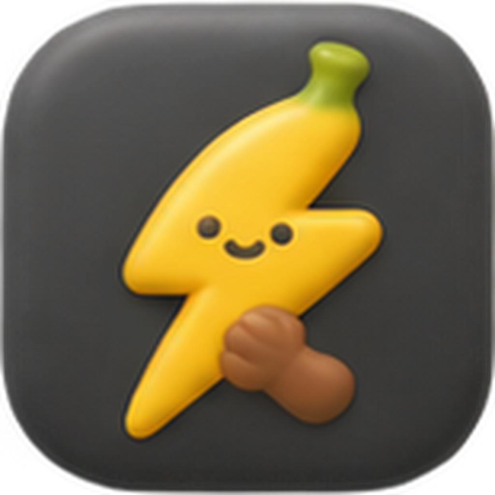

<p align="center">
  
</p>

# Wookey

Wookey is a Mac launcher for **finding apps and files, retrieving clipboard items, and running recurring tasks with a shortcut**. It's free and open source, and runs on Apple Silicon and Intel Macs with macOS 14 or later.

[Download the stable release](https://github.com/movvgli/Wookey/releases/latest) · [Website](https://movvgli.github.io/Wookey/) · [Release history](https://github.com/movvgli/Wookey/releases) · [한국어](README.md)

## Start with quick search

- Use **Option–Space** to search for files and folders by name across the Mac’s Spotlight index. Enter a full path to open an item directly.
- Press **Option–Space** to find installed apps, saved links, templates, and workflows. Press **Return** to open the selection or **Command–Return** to search the web in your default browser. Choose Google, Naver, Daum, or Nate in **Settings → General**. You can also open a web address, run a calculation, or convert currencies.
- Search for **Open Clipboard** or **Open Folder** to jump to your history. Recent clipboard and drawer items are also available in search.
- Give links and workflows search aliases, or assign a global shortcut to an app or link.

## Clipboard history and the drawer

Retrieve text and images you've copied before. While dragging a file, image, or web link, shake the pointer twice to open the drawer. Drag the mascot to move the drawer. Use **Shift-click** or **Command-click** to select several items and drag them into another app together.

Adjust shake sensitivity in **Settings → General** and change what Wookey retains in **Settings → Retention**. On macOS 26 or later, the drawer's thought bubble uses Liquid Glass.

## Templates, workflows, and window layouts

- Save frequently used text, links, lists, and images as **templates**. Assign a search alias or keyboard shortcut in the template editor.
- Build a **workflow** from steps such as opening apps, links, or files, pasting a template, pressing Return, waiting, and arranging windows. Run it from a global shortcut, the menu bar, or Apple Shortcuts.
- Save the display and screen region for each app window in a **window layout**. Restore it with a shortcut or add it to a workflow.
- Map fn, right Command, or right Option to a configurable **Hyper key** for shortcuts.

## Appearance

Open **Settings → Theme** to choose white, yellow, sky blue, brown, or dark. Choose Wookey and Banana or Sharkey and Coral, and independently switch between 3D and Fluffy icons.

## Installation and permissions

Download the Apple-notarized DMG from the [latest stable release](https://github.com/movvgli/Wookey/releases/latest), then move Wookey into **Applications**. Open the app and try **Option–Space**.

Automated pasting and window placement require Accessibility permission. Two-step shortcuts and the Hyper key also require Input Monitoring. [Installation, permissions, and updates](docs/INSTALL.md)

Releases marked **Pre-release** are test builds pending Apple notarization. Stable in-app updates use the stable release channel.

## Data storage

Workflows, templates, clipboard history, and drawer items are stored on your Mac by default. With optional iCloud sync, you can store workflows, templates, shortcuts, window layouts, and copies of attachments in a private iCloud Drive folder. Clipboard history and drawer items stay on your Mac. [Privacy and sync details](docs/PRIVACY.md)

## Development and contributing

Use Xcode and a Swift 6 toolchain. Regenerating the Xcode project requires XcodeGen. The release tags identify the source used for the stable installers.

```sh
swift test
./script/build_and_run.sh
```

[Contributing](CONTRIBUTING.md) · [Security](SECURITY.md) · [Distribution](docs/DISTRIBUTION.md) · [MIT license](LICENSE)
