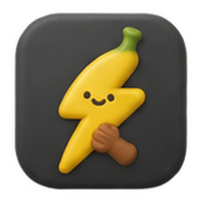

<p align="center">
  
</p>

# Wookey

**앱과 링크를 찾고, 복사한 내용과 파일을 꺼내 쓰고, 반복 작업을 단축키로 실행하는 macOS 앱입니다.** Apple Silicon과 Intel을 지원하며 macOS 14 이상에서 사용할 수 있습니다. 무료 오픈소스 앱으로, 별도 계정 없이 시작할 수 있습니다.

[프리뷰 릴리스](https://github.com/movvgli/Wookey/releases) · [정식 릴리스](https://github.com/movvgli/Wookey/releases/latest) · [공식 웹사이트](https://movvgli.github.io/Wookey/) · [English](README.en.md)

## 무엇을 할 수 있나요?

| 기능 | 사용 방법 |
| --- | --- |
| 빠른 검색 | **⌥ Space**로 설치된 앱, 저장한 링크, 템플릿과 워크플로를 찾습니다. Enter로 선택한 항목을 열거나 실행하고, **⌘ Enter**로 입력한 내용을 기본 브라우저에서 Google로 검색합니다. 웹 주소 입력, 계산과 환율 변환도 지원합니다. |
| 앱과 링크 | 즐겨 쓰는 앱이나 링크에 단축키를 지정합니다. 링크나 워크플로에는 쉼표로 구분한 검색 키워드를 여러 개 등록할 수 있습니다. |
| 클립보드와 우키 서랍 | 복사 기록에서 이전 항목을 다시 복사합니다. Finder나 브라우저에서 파일·이미지·웹 링크를 끌다가 두 번 흔들어 서랍을 열고, 담은 항목을 나중에 열거나 다른 앱으로 꺼내 씁니다. |
| 템플릿 | 자주 쓰는 문구를 서식, 링크, 목록, 인라인 이미지와 함께 저장합니다. 검색창에서 복사하거나 워크플로에 넣어 붙여넣을 수 있습니다. |
| 워크플로 | 앱·링크·파일 열기, 템플릿 붙여넣기, Enter 입력, 대기와 창 배치를 원하는 순서로 연결합니다. 전역 단축키, 메뉴 막대 또는 macOS 단축어에서 실행할 수 있습니다. |
| 창 레이아웃 | 앱 창을 어느 모니터의 어느 영역에 둘지 저장합니다. 단축키로 바로 불러오거나 워크플로에 넣어 사용할 수 있습니다. |
| 화면과 아이콘 꾸미기 | 화이트·옐로우·하늘색·브라운·다크 화면 테마를 고릅니다. 우키와 바나나, 샤키와 산호 중 캐릭터 조합을 고르고 3D 또는 플러피 아이콘을 적용할 수 있습니다. |

## 다운로드와 첫 실행

[정식 릴리스](https://github.com/movvgli/Wookey/releases/latest)는 Developer ID 서명과 Apple 공증을 마친 설치 파일을 제공합니다. 이전 릴리스에 표시되는 **Monkey**와 **Wikey**는 Wookey의 이전 이름입니다.

위 기능은 [프리뷰 릴리스](https://github.com/movvgli/Wookey/releases)를 기준으로 설명합니다. 최신 기능을 체험하려면 릴리스 목록의 상단에서 **Pre-release**로 표시된 Wookey의 DMG를 받으세요. 프리뷰는 Apple 공증 전 빌드이며 정식 자동 업데이트에는 배포되지 않습니다.

1. DMG를 열고 앱을 **응용 프로그램** 폴더로 옮깁니다.
2. 앱을 실행하고 **⌥ Space**로 평소 쓰는 앱을 찾아 실행해 보세요.
3. 여러 동작을 묶고 싶다면 **새 워크플로 → 여러 동작 연결…**을 고릅니다.

자동 붙여넣기, 키 입력과 창 배치에는 **손쉬운 사용** 권한이 필요합니다. 두 단계 단축키에는 **입력 모니터링**도 필요합니다. [설치·권한·업데이트 안내](docs/INSTALL.md)

## 데이터 저장

설정, 템플릿, 클립보드 기록과 우키 서랍은 기본적으로 Mac에 저장됩니다. 선택적 iCloud 동기화를 켜면 워크플로, 템플릿, 단축키, 창 레이아웃과 워크플로 첨부 파일 사본을 개인 iCloud Drive에 보관할 수 있습니다. 클립보드 기록과 서랍은 Mac에 남습니다. [개인정보 및 동기화 안내](docs/PRIVACY.md)

## 개발과 기여

Xcode와 Swift 6 도구 체인이 필요합니다. Xcode 프로젝트를 재생성할 때는 XcodeGen을 사용합니다.

```sh
swift test
./script/build_and_run.sh
```

[기여 안내](CONTRIBUTING.md) · [보안 신고](SECURITY.md) · [배포 안내](docs/DISTRIBUTION.md) · [MIT 라이선스](LICENSE)
